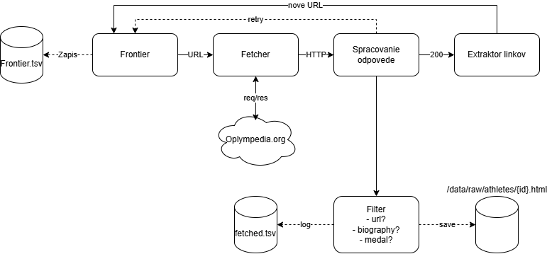

# VINF 2026/27
- Adam Pečenka

## Setup

- Python 3.10+
- pip install requests

## Crawler
`python main.py crawl`

It has no page limit. It stops when the queue is empty, when the site answers
403, or when you press Ctrl-C. Running the same command again resumes where it
stopped.

Keep the repo inside the WSL filesystem (not under /mnt/c), many small files
are slow there. Windows sleep also pauses WSL, and with it the crawl.

### TLDR

- Starts at the base URL and follows only the whitelisted links
  (`URL_WHITELIST` in `constants.py`), breadth first.
- Waits the `Crawl-delay` from robots.txt between requests (10 s on Olympedia).
- Stores an athlete page only if it has a Biography section and at least one
  medal. Every other page is read for links and discarded.

### Files

| Path | Purpose |
|---|---|
| `data/crawler/frontier.tsv` | every discovered URL, in discovery order (the queue) |
| `data/crawler/fetched.tsv` | one row per fetch attempt; the last row of a URL is its state |
| `data/raw/athletes/{id}.html` | stored athlete pages, raw bytes |

Pseudo statuses in `fetched.tsv`: `0` network error, `-1` blocked by robots.txt,
`-2` redirected off-site, `-3` gave up after repeated failures.

### Extractor
`python main.py extract`

Reads every `data/raw/athletes/{id}.html` and rewrites two files. The output is
written to `.tmp` files and swapped in at the end, so a rerun or Ctrl-C never
leaves a half written TSV. Parsing is regex only.

| Path | Content |
|---|---|
| `data/extracted/athletes.tsv` | one row per athlete: names, born/died, measurements, affiliations, NOC, nationality, medals, other participations, list mentions, biography and the mined fields |
| `data/extracted/results.tsv` | one row per event the athlete competed in: games, year, season, sport, discipline, event, team, position, medal. Joins to `athletes.tsv` on `athlete_id` |

Sections are found by their `<h2>` title, the results columns through the table
header. Multi-valued fields are joined with ` | `. Pages with a missing section
are reported as `[!]` (first ones per page, then a summary count).

Mined from the biography (rule based, the whole sentence is kept for each hit):
`career_events`, `post_career` + `post_career_roles`, `other_sports`,
`world_records_text`. `world_records` comes from "List mentions". All patterns
are in `constants.py`.

### Diagram

