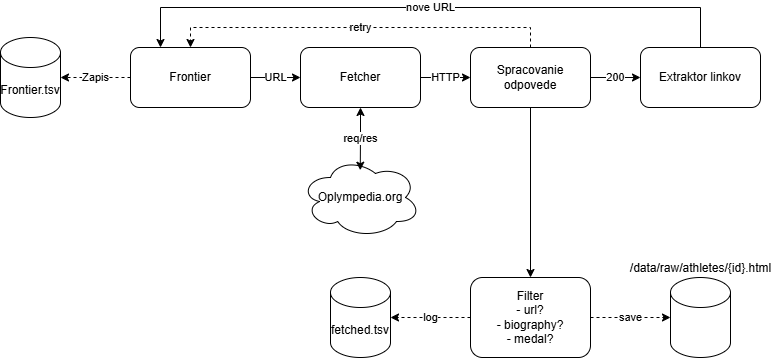
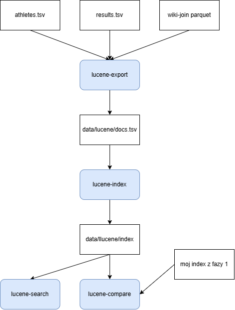

# VINF 2026/27
- Adam Pečenka

## Setup

- Python 3.10+
- pip install requests
- Wikipedia stages: PySpark 3.4, Java 17, on Windows `HADOOP_HOME` with
  `winutils.exe`. The dump path comes from `VINF_WIKI_DUMP`.
- Lucene stages: Docker (image `coady/pylucene:10.0.0`)

## Crawler
`python main.py crawl`

It has no page limit. It stops when the queue is empty, when the site answers
403, or when you press Ctrl-C. Running the same command again resumes where it
stopped.

Keep the repo inside the WSL filesystem (not under /mnt/c), many small files
are slow there. Windows sleep also pauses WSL, and with it the crawl.

### TLDR

- Starts at the base URL and follows only the whitelisted links
  (`URL_WHITELIST` in `regexes/crawler.py`), breadth first.
- Waits the `Crawl-delay` from robots.txt between requests (10 s on Olympedia).
- Stores an athlete page only if it has a Biography section and at least one
  medal. Every other page is read for links and discarded.

### Files

| Path | Purpose |
|---|---|
| `data/crawler/frontier.tsv` | every discovered URL, in discovery order (the queue) |
| `data/crawler/fetched.tsv` | one row per fetch attempt; the last row of a URL is its state |
| `data/raw/athletes/{id}.html` | stored athlete pages, raw bytes |

Pseudo statuses in `fetched.tsv`: `0` network error, `-1` blocked by robots.txt,
`-2` redirected off-site, `-3` gave up after repeated failures.

### Extractor
`python main.py extract`

Reads every `data/raw/athletes/{id}.html` and rewrites two files. The output is
written to `.tmp` files and swapped in at the end, so a rerun or Ctrl-C never
leaves a half written TSV. Parsing is regex only.

| Path | Content |
|---|---|
| `data/extracted/athletes.tsv` | one row per athlete: names, born/died, measurements, affiliations, NOC, nationality, medals, other participations, list mentions, biography and the mined fields |
| `data/extracted/results.tsv` | one row per event the athlete competed in: games, year, season, sport, discipline, event, team, position, medal. Joins to `athletes.tsv` on `athlete_id` |

Sections are found by their `<h2>` title, the results columns through the table
header. Multi-valued fields are joined with ` | `. Pages with a missing section
are reported as `[!]` (first ones per page, then a summary count).

Mined from the biography (rule based, the whole sentence is kept for each hit):
`career_events`, `post_career` + `post_career_roles`, `other_sports`,
`world_records_text`. `world_records` comes from "List mentions". All patterns
are in `regexes/extractor.py`.

### Indexer
`python main.py index`

Builds an inverted index from `data/extracted/athletes.tsv` (one athlete = one
document, the indexed columns are `INDEX_TEXT_COLUMNS` in `constants/indexer.py`). The
text of the athlete's rows in `results.tsv` (`INDEX_RESULT_COLUMNS`, joined on
`athlete_id`) is added to the same document. It is rebuilt from scratch on every
run. Tokens are lower-cased, accents are stripped, no stop words and no
stemming. Construction is SPIMI: terms go straight into an in-memory
dictionary, a block is sorted and written to disk when it reaches
`INDEX_BLOCK_MAX_POSTINGS` postings, then all blocks are merged.

| Path | Content |
|---|---|
| `data/index/dictionary.tsv` | `term`, `df`, `offset` (byte position of its line in `postings.tsv`), sorted by term |
| `data/index/postings.tsv` | one line per term: the term, then its postings as `doc_id:tf` separated by commas, ordered by doc id |
| `data/index/docs.tsv` | `doc_id`, `athlete_id`, `full_name`, `length` (number of tokens), `norm` (Euclidean length of the document's log-tf vector) |

The three files are swapped in together at the end of the build.

### Search
`python main.py search swimming gold --top 10 --rank all --mode and`

The dictionary and the document table are loaded into memory, the postings
lists are read from disk. `--rank` picks the ranking, the default `all` prints
every ranking one after the other. `--mode` picks which documents are scored:

| `--mode` | Documents scored |
|---|---|
| `and` (default) | only athletes that contain every query word. The postings lists are intersected starting from the rarest word. A word that is not in the index gives no hits. |
| `or` | every athlete that contains at least one query word |

A document gets the same score in both modes, `and` only removes the documents
that miss a word. The two tf-idf rankings follow the lecture example:

- query weight `w(t,q) = tf(t,q) * idf(t)`
- document weight `w(t,d) = (1 + log10 tf(t,d)) / ||d||`
- `Score(q,d) = sum over t in q of w(t,q) * w(t,d)`

| `--rank` | Formula |
|---|---|
| `idf` | tf-idf with `idf = log10(N / df)` |
| `prob` | tf-idf with the probabilistic `idf = max(0, log10((N - df) / df))` |
| `bm25` | Okapi BM25, `idf = max(0, log10((N - df + 0.5) / (df + 0.5)))`, `k1 = 1.2`, `b = 0.3` (`BM25_K1`, `BM25_B` in `constants/indexer.py`), document length in tokens |

### Diagram



## Wikipedia (Spark)

```
python main.py wiki-parse --input $env:VINF_WIKI_DUMP --output data/wiki/pages_full_parquet
python main.py wiki-filter
python main.py wiki-extract
python main.py wiki-join
```

| Stage | Output | What it does |
|---|---|---|
| `wiki-parse` | `data/wiki/pages_full_parquet` | dump XML -> one row per article, redirects dropped |
| `wiki-filter` | `data/wiki/pages_relevant_parquet` | keeps a page if any flag fires (person category / infobox, Olympic title / category / medal, Olympedia link); flags kept as columns |
| `wiki-extract` | `data/wiki/people_parquet` | person pages only: infobox attributes, lead and body text |
| `wiki-join` | `data/joined_parquet`, `data/joined_full_parquet` | Olympedia athletes <-> Wikipedia people |

`wiki-join` matches in tiers, best first: 0 the page cites the athlete's
Olympedia id, 1 name + full birth date, 2 name + birth year. Pages citing an id
whose birth year doesn't fit go to `joined_parquet_conflicts`.

`joined_parquet` holds the matched pairs. `joined_full_parquet` is the full outer
view restricted to the topic, column `match_type`:

| `match_type` | Rows |
|---|---|
| `both` | matched (athlete, page) pairs, same as `joined_parquet` |
| `olympedia_only` | athletes without a page, Wikipedia columns null |
| `wiki_only` | person pages with at least one Olympic flag, not matched to any athlete; Olympedia columns null |

`id_conflict` marks the conflict pages. It is built with anti-joins and a union,
not a Spark full outer join (that can't be broadcast over the 2 M page side).

## Lucene (PyLucene in Docker)

```
python main.py lucene-export
.\scripts\run_in_lucene.ps1 main.py lucene-index
.\scripts\run_in_lucene.ps1 main.py lucene-search "sport:swimming born_year:[1980 TO 1989]"
.\scripts\run_in_lucene.ps1 main.py lucene-compare
```

`lucene-export` (host, Spark) writes `data/lucene/docs.tsv`, one row per Lucene
document: every athlete (results aggregated, best Wikipedia page, gaps in
height / weight / places filled from Wikipedia) plus every `wiki_only` page.
`doc_id` is the `athlete_id`, or `w` + page id for `wiki_only`. The container
only reads this TSV, it needs no Spark. Field kinds (phrase, prose, keyword,
int) are listed in `constants/lucene.py`.

Search uses classic Lucene syntax: bare words hit the boosted fields of
`LUCENE_SEARCH_BOOSTS`, `field:word`, phrases, `AND / OR / NOT`, fuzzy `~`,
prefix `*`, and numeric ranges such as `medals_total:[3 TO *]`. Filters:
`match_type:wiki_only` or `-match_type:wiki_only` (athletes only),
`--sport-medal aquatics:gold`, `--discipline-medal swimming:gold`.

`lucene-compare` runs the test queries of `indexer/lucene_truth.py` against the
own index and the Lucene index (precision / recall, rank of a known athlete,
latency). It compares athletes only: `wiki_only` documents are excluded, the
own index doesn't contain them.

